# Tidewell Claims

An insurance claims portal built with **Angular 22**, for a fictional insurer called Tidewell. Customers file auto or home claims through a five-step form and track them online. Staff work through a claims queue where each action follows the claim workflow and the user's role.

The backend is mocked inside the app (an HTTP interceptor that behaves like a REST API and keeps its data in `localStorage`). It runs with no server and deploys as a static site.

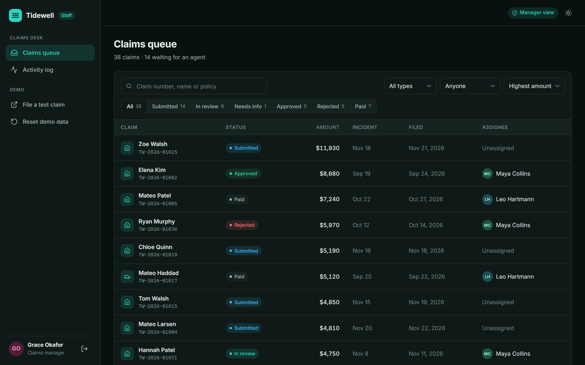

| Error summary                                       | Items with live totals                     |
| --------------------------------------------------- | ------------------------------------------ |
| 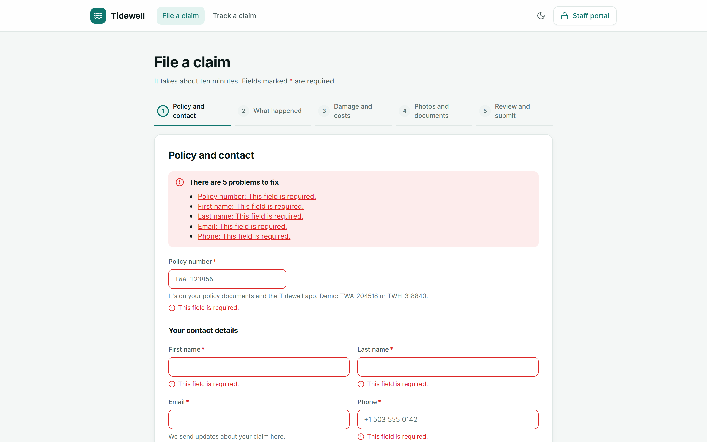 | 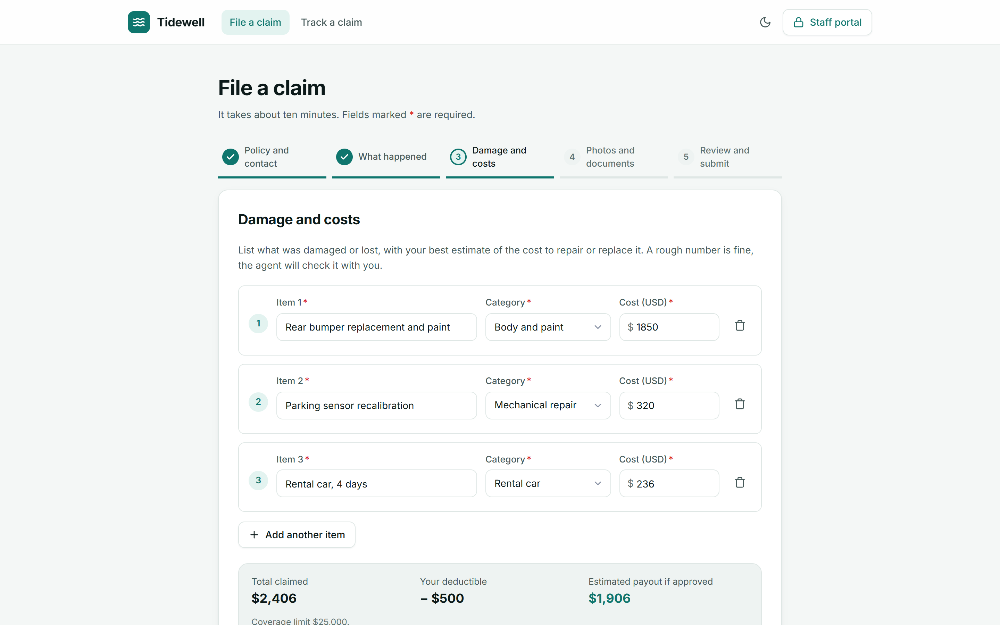 |

| Conditional fields                                    | Uploads with previews                              |
| ----------------------------------------------------- | -------------------------------------------------- |
| 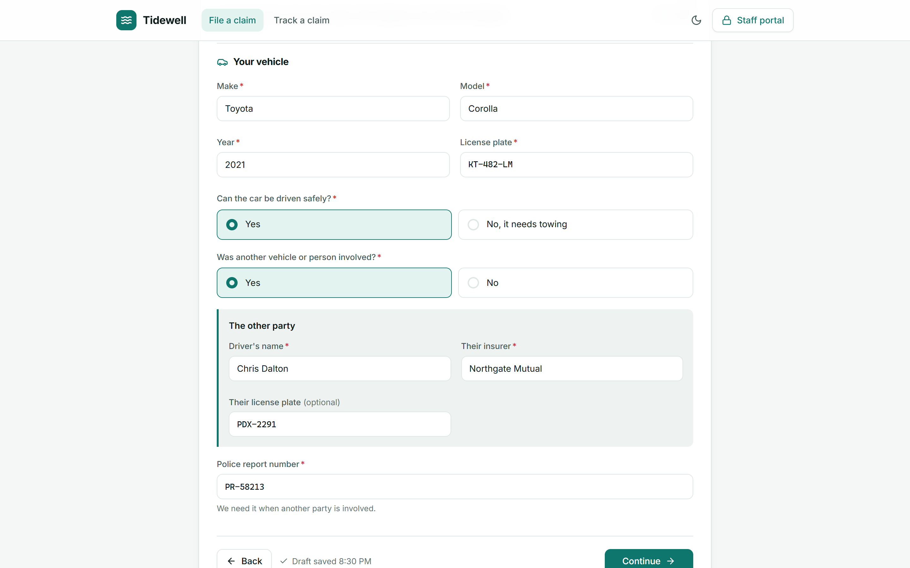 | 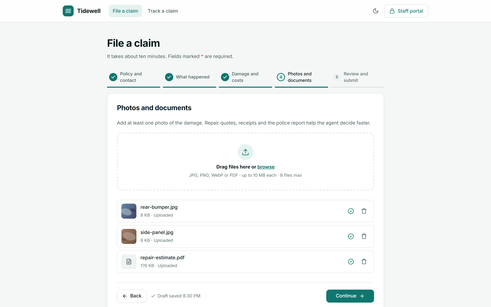 |

| Agent view: actions locked by role                       | Claimant reply in the history                    |
| -------------------------------------------------------- | ------------------------------------------------ |
| 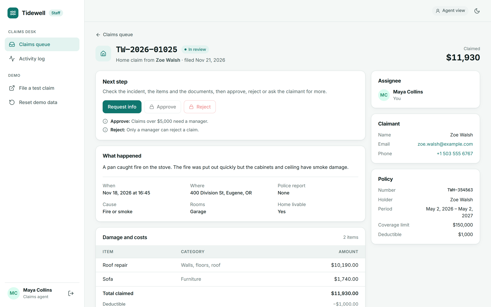 | 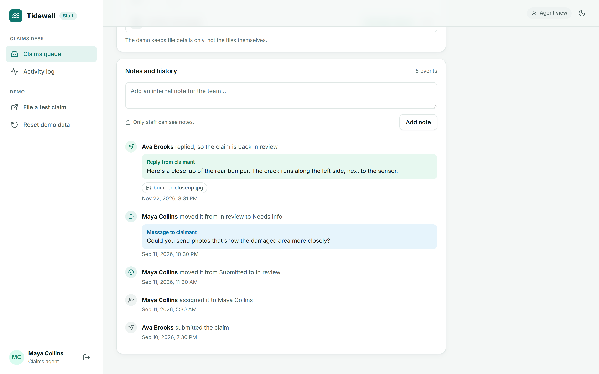 |

| Claimant answers a request                                | Activity log                                         |
| --------------------------------------------------------- | ---------------------------------------------------- |
| 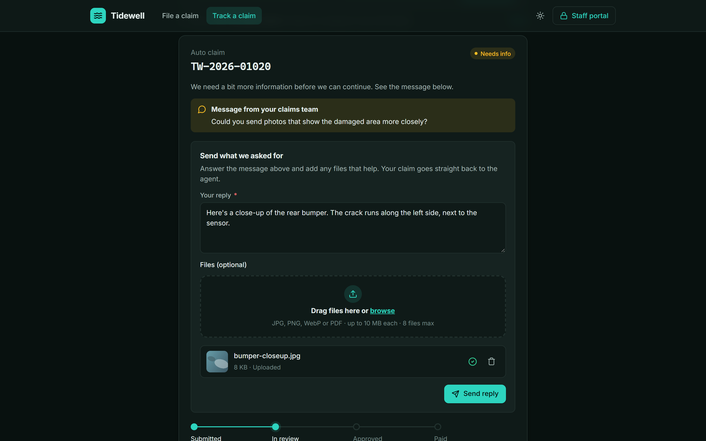 | 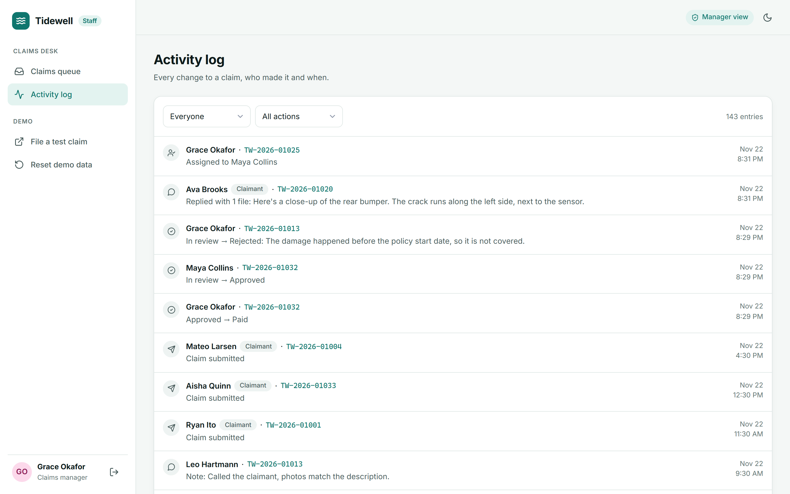 |

| Home                               | Mobile                                              |
| ---------------------------------- | --------------------------------------------------- |
| 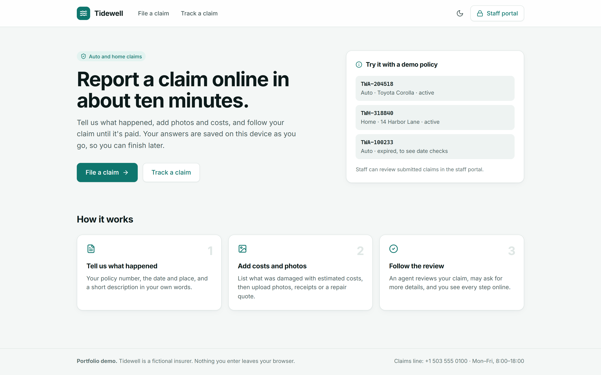 | 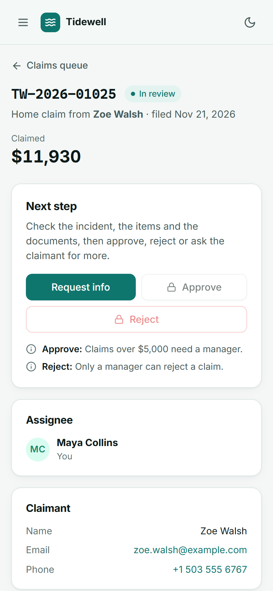 |

## Try it

**As a customer**

- File a claim with policy `TWA-204518` (auto) or `TWH-318840` (home). `TWA-100233` is expired, so any incident date fails the policy period check.
- On **Track a claim**, click **Try it** to open a claim that is waiting for more information, then send a reply with a photo.

**As staff**, open **Staff portal**. There are no passwords; pick a demo account:

| Account      | Role    | Can do                                                                   |
| ------------ | ------- | ------------------------------------------------------------------------ |
| Maya Collins | Agent   | Work on her own claims, ask for more info, approve up to $5,000          |
| Leo Hartmann | Agent   | Same as Maya                                                             |
| Grace Okafor | Manager | Assign claims to anyone, approve any amount, reject, mark claims as paid |

**Reset demo data** in the staff sidebar puts everything back to the start.

## Features

### Claim form (customer side)

- **Five steps**: policy and contact, what happened, damage and costs, photos and documents, review. The step is kept in the URL (`?step=3`), so Back and Forward work.
- **Typed reactive forms** (`NonNullableFormBuilder`), one form service shared by the step components.
- **Async policy lookup**: the policy number is checked against the API as you type, with a debounce. A match fills in the holder's name and the vehicle.
- **Conditional fields** with `enable()`/`disable()`, so hidden fields are left out of both validation and the value:
  - auto and home claims ask different questions;
  - another driver involved → their details;
  - another driver or a theft → a police report number is required.
- **Cross-field validation**: the incident date must fall inside the policy period and can't be in the future. The item total can't go over the coverage limit.
- **FormArray of damaged items**: add and remove rows, with a running total, deductible and estimated payout. Focus moves to the new row.
- **Uploads**: drag and drop, type and size checks, progress per file, retry, cancel, image previews.
- **Draft autosave** to `localStorage`, with a "continue where you left off" prompt. A `CanDeactivate` guard warns before you leave with unsaved changes.
- **Error summary** at the top of the step, linking to each invalid field. Fixed fields drop out of the list as you fix them.
- **Tracking page**: status, progress line, history and messages from the claims team. When the team asks for more information, the customer replies right there with text and files.

### Staff portal

- **Claims queue**: search, status tabs with counts, type and assignee filters, sorting and pagination. All filters live in the URL.
- **Claim detail**: incident, items, policy, documents, internal notes and a full history.
- **Workflow rules** as plain functions in `core/workflow.ts`, used by both the UI and the API. The API enforces them too. For example:
  - an agent must be assigned to a claim before working on it;
  - agents can approve up to $5,000;
  - only managers reject claims or mark them paid;
  - requesting info or rejecting needs a message for the customer.
- **Blocked actions show why**: disabled buttons have the reason next to them, linked with `aria-describedby`.
- **Activity log** of every change, filterable by person and action.

### Across the app

- **Auth**: token interceptor, route guards, and a redirect back to sign-in on a 401 that keeps the page you were on.
- **Feedback**: loading skeletons, empty and error states with retry, and toasts for failed writes.
- **Light and dark themes**, with no flash on load.
- **Responsive** down to 360px.
- **Accessibility**: keyboard friendly, `aria-invalid` and `aria-describedby` on fields, focus moved to the step heading when the step changes.

## Tech stack

- **Angular 22**:
  - standalone components, zoneless change detection, `OnPush`;
  - signals: `signal`, `computed`, `input()`, `output()`, `viewChild()`;
  - `rxResource`, the new control flow with `@let`;
  - lazy-loaded routes, component input binding for route params, view transitions.
- **Reactive forms** with typed controls, custom sync and async validators, `FormArray`, and `control.events`.
- **RxJS** for the debounced search, URL-driven loading, upload progress and async validation.
- **SCSS** with CSS custom properties for theming.
- **TypeScript** in strict mode.

## Getting started

Requires Node.js 24.15+ (or 22.22+).

```bash
npm install
npm start
```

Open http://localhost:4200.

```bash
npm run build   # production build in dist/tidewell-claims
```

## Project structure

```
src/app
├── core/
│   ├── mock/             # fake REST backend + seeded claims
│   ├── http/             # error interceptor + helpers
│   ├── api.ts            # typed API client
│   ├── auth.ts           # session, token interceptor, guards
│   ├── validators.ts     # form validators and formatting
│   └── workflow.ts       # who can move a claim where, and why not
├── shared/
│   ├── upload/           # upload queue + drop zone, used by the form and replies
│   └── ui/               # icon, avatar, status badge, toasts, confirm dialog
├── layout/               # public header and footer
└── features/             # lazy-loaded pages
    ├── home/
    ├── claim/            # five-step wizard, form service, steps
    ├── track/            # status page and claimant reply
    └── staff/            # sign-in, shell, queue, claim detail, activity log
```

## API

The mock backend answers these endpoints. A real backend with the same contract can replace it.

| Method | Path                         | Notes                                                    |
| ------ | ---------------------------- | -------------------------------------------------------- |
| GET    | `/api/policies/:number`      | Policy lookup for the claim form                         |
| POST   | `/api/claims`                | Submit a claim (validated again on the server)           |
| POST   | `/api/uploads`               | File upload with progress events                         |
| GET    | `/api/track?number&lastName` | Public view of a claim, without internal notes           |
| POST   | `/api/track/reply`           | Claimant answers a request for information               |
| POST   | `/api/auth/login`            | Demo sign-in, returns a token                            |
| GET    | `/api/claims`                | Queue: `q`, `status`, `type`, `assignee`, `sort`, `page` |
| GET    | `/api/claims/:id`            | Full claim                                               |
| POST   | `/api/claims/:id/transition` | Change status; `403` with a reason if not allowed        |
| POST   | `/api/claims/:id/assign`     | Assign to a team member                                  |
| POST   | `/api/claims/:id/notes`      | Add an internal note                                     |
| GET    | `/api/activity`              | Audit log: `actor`, `action`, `page`                     |

To connect a real API, remove `mockBackendInterceptor` from `app.config.ts`. The components don't need to change.
